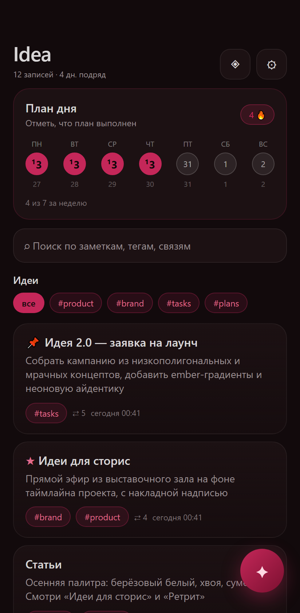
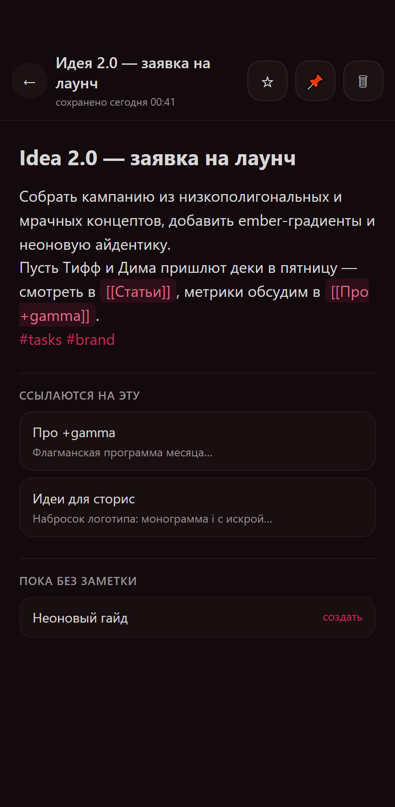
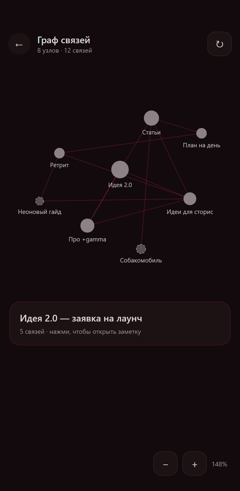
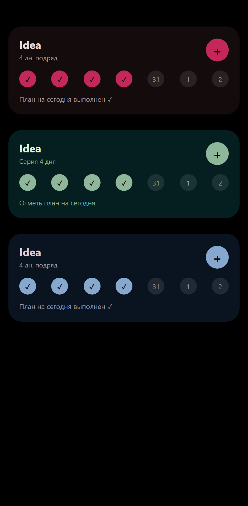

# Idea

Лёгкий и быстрый мобильный блокнот для идей в духе Obsidian. Нативный Android, Jetpack Compose, полностью офлайн. Заметки со связями [[wiki]], теги #, интерактивный граф, мгновенный fuzzy-поиск и виджет с чек-ином за день.

## Возможности

- **Заметки и Markdown** — создание, редактирование, удаление, автосохранение с задержкой 420 мс. Название берётся из заголовка или первой строки.
- **Связи между заметками** — ввод [[название]] с автодополнением; в редакторе видны исходящие ссылки, обратные ссылки и ссылки-призраки, по которым заметку можно создать одним тапом.
- **Граф связей** — force-directed карта всех заметок и ссылок с пинч-зумом, перетаскиванием и тапом по узлу; несозданные заметки показаны призрачными узлами.
- **Теги** — автодополнение при вводе, цветные пилюли, фильтр ленты по тегу, отдельный экран тега.
- **Мгновенный поиск** — fuzzy-поиск по названиям, тексту, тегам и связям с моментальной выдачей и контекстными сниппетами.
- **Быстрый захват идеи** — кнопка на главном экране, полноэкранный оверлей из виджета или лончер-шортката: сохранить мысль можно не заходя в приложение.
- **Главный экран** — лента заметок, чек-ин карта «План дня» с серией дней, фильтры по тегам, поиск и переход к графу.
- **Синхронизация** — экспорт/импорт хранилища JSON по HTTP, слияние last-write-wins, фоновая синхронизация через WorkManager и ручная в настройках.
- **Оффлайн-режим** — база Room локальна, приложение работает без сети и синхронизируется при подключении.
- **Виджет** — чёрный виджет на главный экран: кнопка «+» для мгновенной записи, ряд из 7 дней с галочками (тап по дню отмечает «план выполнен» прямо из виджета), серия и последняя заметка.
- **Три темы** — Ember (бордово-угольная), Pine (хвойно-зелёная), Dusk (сине-сумеречная); переключение в настройках.

## Интерфейс

Макеты экранов 1:1 по реализации (реальные скриншоты с устройства добавим позже).

| Главная | Редактор |
|---|---|
|  |  |
|  |  |

## Скачивание

Готовый подписанный APK — в [релизах](../../releases) (например, Idea-1.0.0.apk). Требуется Android 8.0 (API 26) или новее.

## Сборка

```bash```
./gradlew :app:assembleDebug          # отладочный APK
./gradlew :app:testDebugUnitTest      # юнит-тесты Markdown/Fuzzy/Day
./gradlew :app:assembleRelease        # нужен keystore.properties (не в репозитории)
``````

Требуется JDK 17 и Android SDK (compileSdk 36).

## Синхронизация

Приложение работает по простому HTTP-протоколу: PUT/GET на адрес вида <сервер>/vault/<имя_устройства> с JSON-документом всего хранилища (заметки, чек-ины, теги). Слияние — last-write-wins по каждой записи, конфликты не приводят к потере данных.

В репозитории есть крошечный референс-сервер:

```bash```
python server/sync_server.py --host 0.0.0.0 --port 8787
``````

Затем в приложении: Настройки → Синхронизация → адрес http://<ip-компьютера>:8787 и уникальное имя устройства. Сервер хранит по одному JSON-файлу на устройство в папке vaults/ и не содержит авторизации — держите его в доверенной локальной сети или за reverse-proxy с аутентификацией.

## Архитектура

- **UI** — Jetpack Compose + Material 3, Navigation Compose, edge-to-edge, три палитры тем.
- **Данные** — Room (KSP): заметки, ссылки, теги, связи заметка-тег, чек-ины, состояние синхронизации. Индексация ссылок и тегов пересчитывается при каждом сохранении.
- **Фон** — WorkManager для периодической синхронизации (30 минут при наличии сети).
- **Виджет** — Glance AppWidget, обновление через updateAll.
- **Сеть** — OkHttp + kotlinx.serialization для JSON-хранилища.
- **Тесты** — JUnit для Markdown-парсера, fuzzy-поиска, работы с датами и серии дней.

Приватность по умолчанию: всё хранится только на устройстве; сеть используется исключительно для синхронизации, если вы её настроили.

## Лицензия

MIT — см. [LICENSE](LICENSE).

